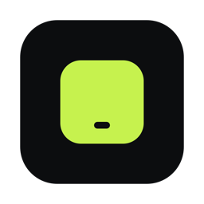
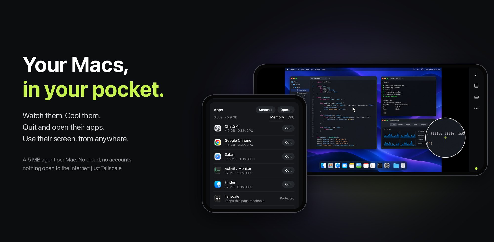
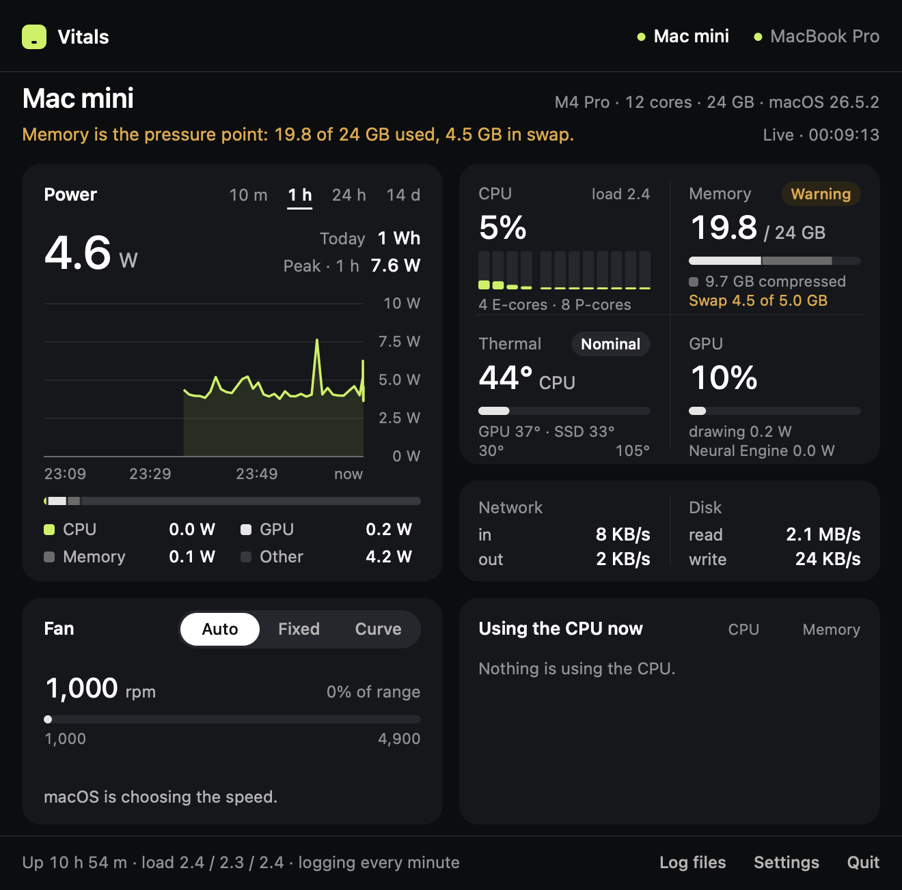
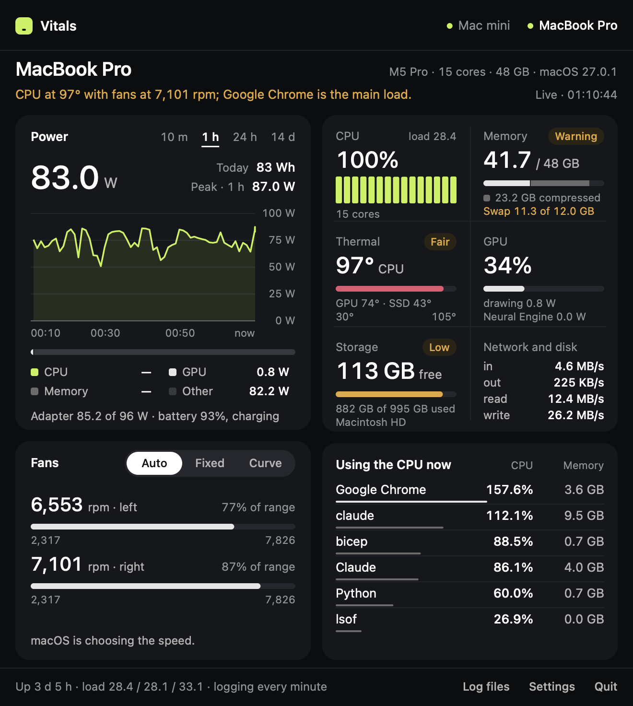
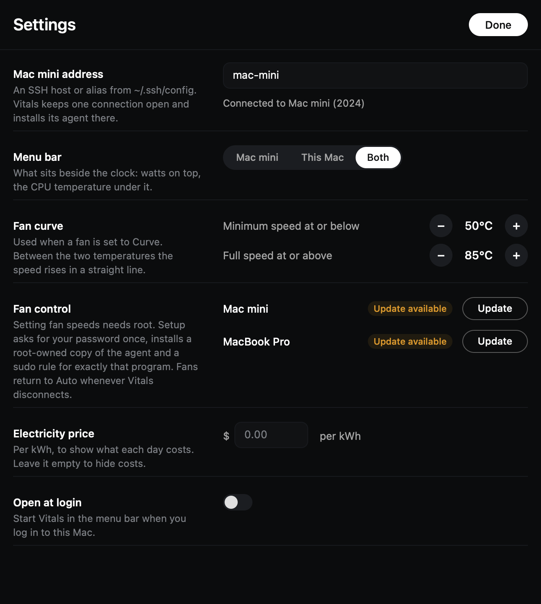
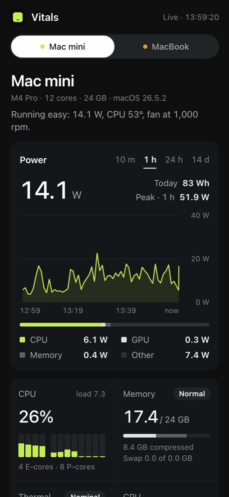
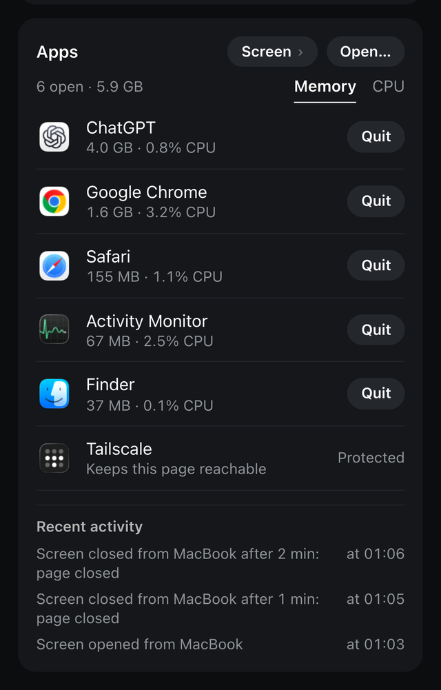
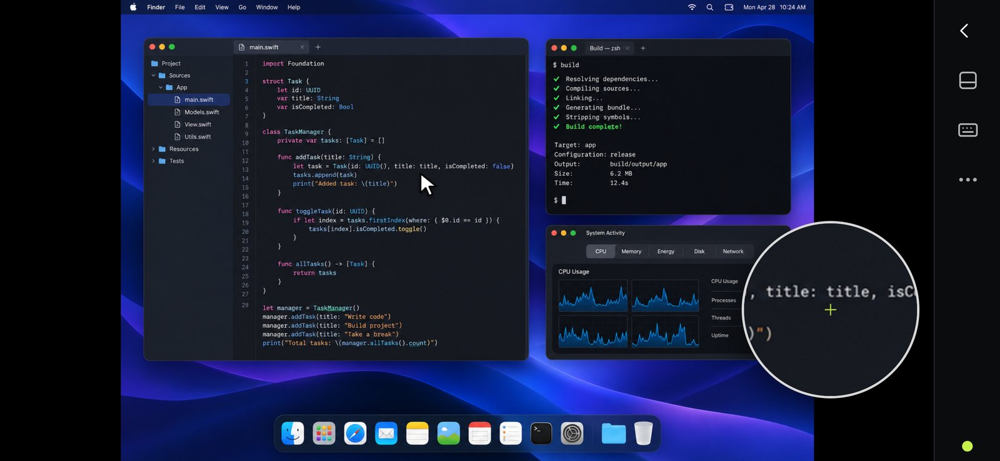
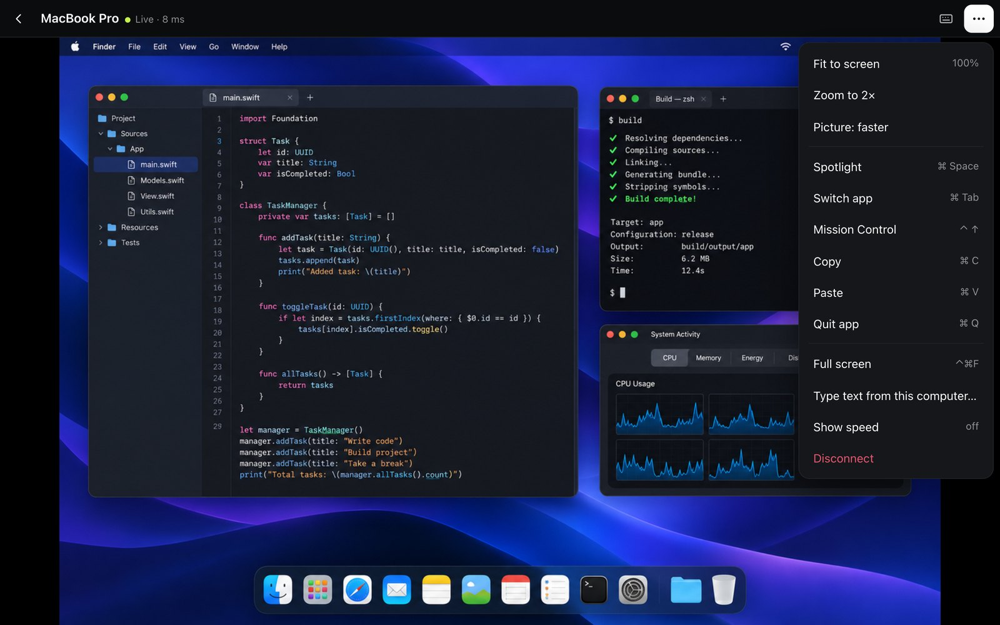
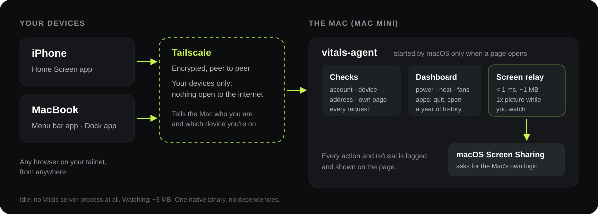

<p align="center"></p>

<h1 align="center">Vitals</h1>

<p align="center"><b>Your Macs, in your pocket.</b><br>
A tiny menu bar app and phone dashboard that watches your Macs, controls their fans, quits and opens<br>
their apps, and puts their screen on your iPhone: from anywhere, with nothing open to the internet.</p>



<p align="center"></p>



Built for a headless Mac mini (a home server, a build box, an AI rig) that you want to keep an eye on
and a hand on, from your laptop or your phone, without a 100 MB monitoring suite, a remote-desktop
subscription or a cloud account.

## At a glance

| You get | It costs |
| --- | --- |
| Watts, CPU per core, memory pressure, temperatures, storage, SSD health and a year of history, for every Mac | A ~5 MB agent on each Mac |
| Fan control: Auto, Fixed or a temperature Curve, with a 95 °C safety ceiling | Nothing until you move a fan |
| A phone dashboard: a Home Screen app on your iPhone | **No process at all** until a page opens it |
| Quit, force quit and open any app on a Mac, from your phone | Off until you name the devices allowed |
| **The Mac's screen on your phone**: see it and use it, with trackpad gestures, a magnifier, a keyboard with ⌘ ⌥ ⌃ ⇧, sideways | A 57 KB viewer, ~1 MB on the Mac while connected, nothing after |
| No App Store, no developer account, no cloud service, no port open to the internet | Your own [Tailscale](https://tailscale.com) network |

What you can do with it:

- **From bed, on your phone:** see that the mini is at 98 °C, find the app behind it, and quit it in
  two taps.
- **From a café, on cellular:** open the mini's screen, answer a dialog nobody was there to
  see, and drag a file into a folder, with a trackpad under your thumb and a magnifier over the pointer.
- **From your MacBook:** click **Screen** in the Vitals menu, or keep a "Mac mini" app in the Dock
  that opens straight onto its screen, full screen, pinch to zoom.
- **Before you leave the house:** set the fans to a quiet curve for an overnight job, and see in the
  morning how many watt-hours it took.
- **Any time:** a year of power, temperature and memory history, and a log of every app quit, every
  screen session and every refused attempt.

What makes it unusual:

- **Zero cost when nobody is looking.** macOS's launchd holds the dashboard's port and starts the
  server only when a page connects; a minute after the last one leaves, it is gone.
- **Remote control without a remote-control app.** The screen comes from macOS's own Screen Sharing;
  Vitals adds a small relay and a phone-first viewer around it. It also switches a Retina Mac to the
  same layout at 1x while you watch, so a quarter of the pixels cross the network, and macOS
  switches it back by itself.
- **Security in layers.** Your tailnet only; your Tailscale account only; only the devices you
  named; only from the Mac's own page; and for the screen, the Mac's own login on top. Every action,
  and every refused attempt, is logged and shown.
- **One native binary per Mac, no dependencies.** AppKit and a hand-written HTTP and WebSocket
  server; the only third-party code is the screen viewer, noVNC, bundled unmodified.

## What it shows

- **Power** — the whole machine's watts right now, where they go (CPU, GPU, memory, other), and how
  much energy each day used. On a MacBook: adapter watts and battery.
- **History** — 10 minutes, 1 hour, 24 hours and 14 days. Each Mac logs one row a minute to CSV, kept
  a year, even while the app is closed.
- **Pressure, in every sense** — a bar per CPU core, load, memory pressure and swap, macOS thermal
  pressure, CPU/GPU/SSD temperatures, GPU load, network and disk throughput, and the processes behind
  the load.
- **Storage** — free space on each Mac's drive (counted as Finder counts it) and any other local drive,
  flagged when it runs low.
- **One finding** — a sentence under the title says what needs attention ("Memory is the pressure
  point: 19.8 of 24 GB used, 4.5 GB in swap").
- **Fans** — Auto, Fixed (drag to a speed) or Curve (follows CPU temperature between two points).



## Light by design

| | Memory | CPU at rest |
| --- | --- | --- |
| Vitals app | ~20–35 MB | ~0.3% |
| Agent on each Mac | ~5 MB | ~0.2% |
| Phone dashboard, nobody looking | no process | — |
| Screen session open (4K Mac) | ~3 MB for Vitals' server | relay < 1 ms added latency |

Native AppKit drawn in a single view: no web view, no SwiftUI, no dependencies. Sampling is 1 s while
the panel is open, 5 s for the menu bar, and the costly process scan only runs while you are looking.

## Requirements

- Apple Silicon Macs (M1 and later), macOS 14 or later.
- For a remote Mac: key-based SSH that works without a password prompt, e.g. a `Host mac-mini`
  entry in `~/.ssh/config`. Tailscale works well.

## Install

**From source** (needs only the Xcode Command Line Tools):

```bash
git clone https://github.com/samvladd/vitals.git && cd vitals && ./build.sh && cp -R build/Vitals.app /Applications/
```

**Or download** `Vitals.zip` from [Releases](https://github.com/samvladd/vitals/releases). The app is not
notarized, so macOS will block the first launch; allow it once in System Settings → Privacy & Security
→ Open Anyway, or run:

```bash
xattr -dr com.apple.quarantine /Applications/Vitals.app
```

Then open Vitals, click the readings in the menu bar → **Settings**, and enter your remote Mac's SSH
host (default `mac-mini`). Vitals copies its agent to `~/.vitals/` on that Mac and starts the logger
there by itself.



## Fan control

Writing fan speeds needs root, so it is opt-in, once per Mac: **Settings → Fan control → Set up**.
It asks for your password once, then installs a root-owned copy of the agent at
`/usr/local/libexec/vitals-agent` and a sudo rule that allows exactly `vitals-agent stream` and nothing
else. Only fan writes go through that copy; everything else runs as you, so updating Vitals never
asks for the password again. By hand:

```bash
sudo "$HOME/Library/Application Support/Vitals/bin/vitals-agent" setup-root
```

```bash
ssh -t mac-mini 'sudo ~/.vitals/vitals-agent setup-root'
```

Safety:

- Above **95 °C** the fans go to full speed, whatever mode you chose.
- Fans return to **Auto** whenever Vitals quits, crashes or loses the connection.
- Speeds are kept within each fan's own minimum and maximum.

Quit other fan apps (Macs Fan Control, Stats' fan module) first, or they will fight over the fans.
Fan control talks to the SMC directly, as those apps do; use it at your own risk.

## On your iPhone



Each Mac can serve a dashboard of its own: the same readings, the power history and fan control,
as a Home Screen web app on your phone or a page on any computer. No App Store, no Apple developer
account, nothing open to the internet: it is reachable only from your own devices on
[Tailscale](https://tailscale.com).

On each Mac you want to see (the agent is at `~/.vitals/vitals-agent` on a remote Mac and at
`~/Library/Application Support/Vitals/bin/vitals-agent` on the one running the app):

```bash
vitals-agent install-serve --peer https://other-mac.your-tailnet.ts.net \
  --allow-origin https://this-mac.your-tailnet.ts.net,https://other-mac.your-tailnet.ts.net
```

This registers `com.vitals.serve` with launchd and runs `tailscale serve --bg 8787`. The first time,
Tailscale prints a link to enable Serve for your tailnet; open it, then run the command again.
`tailscale serve status` shows the address. On the iPhone (with Tailscale connected), open it in
Safari → Share → **Add to Home Screen**; it opens full-screen like an app.

- **Costs nothing while nobody looks.** launchd holds the port (`127.0.0.1:8787` only) and starts
  the server when a page connects; it samples once a second while a page is on screen and exits a
  minute after the last one closes. Idle, there is no extra process at all. History comes from the
  per-minute log the agent already keeps.
- **Two Macs, no relay.** The page on one Mac reads the other straight from its own address; the
  other Mac allows that with `--allow-origin`. When it is asleep the tab says so and when it was last
  seen. From that page the other Mac's fans are read-only; open its own page to change them.
- **Fans** work as in the app, on the Mac whose page you opened (after the one-time fan setup). They
  go back to **Auto** 30 seconds after the last page closes, or 90 seconds after a page stops checking
  in (phone locked), and the 95 °C ceiling still applies.

**Tap any card for more.** CPU, Memory, Thermal, GPU, Fan and Storage open their history for 1 h,
24 h and 14 d from the per-minute log, with the detail behind them: each core, where the memory goes
and which processes hold it, every temperature sensor. Storage adds:

- **"Full in about N days"**, from the free space logged each minute.
- **What's using the space**, measured only when you tap, at most once an hour, capped at 45 s. It
  measures your own folders and your apps' (developer tools, caches, app support, `/Applications`).
  It never opens the places macOS guards with a permission prompt (Desktop, Documents, Downloads,
  Music, Movies, Pictures, the Trash, other apps' data, Apple's own data in Library) or cloud
  folders, so a Mac nobody is sitting at is never left waiting on a dialog. A folder that still
  stalls is abandoned and never opened again. Giving `vitals-agent` Full Disk Access adds Desktop,
  Documents and Downloads; it is optional.
- **SSD health**, the drive's own report (NVMe SMART): wear, data written, spare blocks, errors.
  No root needed.

| While a page is open (Mac mini, M4 Pro) | CPU | Memory |
| --- | --- | --- |
| `vitals-agent serve` | ~2% of one core | ~6.5 MB |
| …with the Apps card open (refreshes every 3 s) | +~0.5% of one core | +~0.1 MB |
| Nobody looking | — | no process |

<br clear="right">

## Quit and open apps from your phone



The dashboard can also list a Mac's apps (one row per app, with the memory and CPU of the app and
all its helpers, sorted by either) and quit them, force quit them, or open one from Applications. It
is **off** until you turn it on, on that Mac, naming the devices that may use it:

```bash
vitals-agent control on --from my-iphone,my-macbook
```

The names are the first part of each device's Tailscale address (`tailscale status` lists them; run
the command without `--from` to see yours). `vitals-agent control` shows what is allowed and the
latest actions; `vitals-agent control off` turns it off again at once.

The Apps card is on that Mac's own page. On the other Mac's page, its tab shows a link there instead:
one Mac's page never controls the other.

Who can do it. Every request has to pass all of these, checked by the agent on each call:

| Check | What it stops |
| --- | --- |
| Reached only through Tailscale, never the internet | Anyone not on your tailnet |
| The **Tailscale account** must be this Mac's own (Tailscale sets it and removes any forged copy) | Someone you shared a device with, a tagged server |
| The **device** must be one you named | Other machines signed in to your account, an old server for example |
| The address must be this Mac's tailnet name | A web page that points its own domain at the Mac (DNS rebinding); this now guards the whole dashboard |
| A change must come from this Mac's own page | Other sites, and the other Mac's page, posting to it |

What it can do. Only quit, force quit and open apps: no shell, no files, no arguments, and opening
is limited to the apps in the Applications folders. **Tailscale can't be quit from the page**, so you
can't lock yourself out. Quit takes two taps; Force quit is offered only when an app is still open
after 8 seconds (usually a "Save changes?" dialog nobody can see on a headless Mac).

Every action, and every refused request, goes to
`~/Library/Application Support/Vitals/control.log`, and the last few show at the bottom of the card
("Quit Safari from iPhone", or in orange, "Blocked a request from …").

The Mac has to be logged in (it is, if the dashboard works), and no macOS permission prompt is
involved. Anyone who can already run programs as you on that Mac could quit your apps anyway, so the
checks are about the network, not the Mac itself. For the screen itself, use Screen Sharing over Tailscale.

<br clear="right">

## Control the screen



With app control on, a Mac can also show its screen on the dashboard: see it and use it from your
phone or another computer, anywhere on your tailnet. Turn it on, on that Mac:

```bash
vitals-agent screen on
```

The Apps card then has a **Screen** button. macOS does the hard part: Vitals relays the page to the
Mac's own Screen Sharing (turn it on in System Settings › General › Sharing), which asks for the
Mac's login. The password goes from the page to macOS, encrypted, and Vitals never sees or keeps it.

On a phone:

| Gesture | Does |
| --- | --- |
| Slide one finger | Moves the pointer, like a trackpad; a magnifier shows what is under it |
| Tap | Click (tap twice to double-click) |
| Hold, then slide | Drag |
| Hold and let go, or tap with two fingers | Right click |
| Two fingers | Scroll, or pinch to zoom in on the picture |

The keyboard button opens the phone's keyboard with a row for esc, tab, ⌘ ⌥ ⌃ ⇧ and the arrows (the
modifiers stay down for the next key: ⌘ then C copies). The menu has Spotlight, app switching,
Mission Control and a box to paste text that is then typed on the Mac. Turn the phone sideways for
the full picture with the controls in a rail beside it. Lock the phone or switch apps and come back:
it reconnects by itself.

From another Mac:



- **Screen** in the Vitals menu (shown for any Mac with Screen on) opens it in your browser.
- In Safari, **File › Add to Dock** makes it an app of its own: a "Mac mini" in the Dock that opens
  straight onto its screen, in its own window.
- The mouse and keyboard just work, with your own pointer always visible. Pinch the trackpad to zoom
  in, push against an edge to move around, and **⌃⌘F** for full screen. If the Mac shares what you
  copy there, Vitals offers to copy it here too.
- The browser keeps a few shortcuts for itself (⌘Q, ⌘W, ⌘Tab, ⌘Space); the menu has Spotlight,
  app switching and Quit for the Mac.

**Faster by default.** A Retina screen is four pixels for each point. While you are connected, the
Mac switches to the matching non-Retina mode (same size, windows stay put), so Screen Sharing sends
a quarter of the data; macOS switches back by itself when the session ends. **Picture: sharper** in
the menu keeps full Retina.

**Same checks, plus macOS's.** Every request passes app control's checks (your Tailscale account, a
named device, this Mac's address and its own page), and then macOS asks for the Mac's login. The relay
only ever connects to Screen Sharing on the Mac itself, and holds at most three sessions. A session
ends when the page closes, after 10 minutes without a touch or a key from that device, or when the
page stops answering (the Mac checks every 25 s, so a phone that lost signal is let go within 75 s,
not left signed in). Each one is in the activity log. `vitals-agent screen off` turns it off.

Screen Sharing itself listens on the Mac's network too, Vitals or not, and its password is what
guards that door. In System Settings › General › Sharing › Screen Sharing, set **Allow access for**
to only your user.

**Light.** The viewer ([noVNC](https://github.com/novnc/noVNC) 1.7.0, MPL-2.0, bundled unmodified) is
57 KB and is only sent when you open the page. On the Mac the relay adds well under a millisecond and
about 1 MB while a session is open; a minute after you leave, nothing is running.

| Measured on an M-series Mac, through Tailscale | Directly | Through Vitals |
| --- | --- | --- |
| Input to screen, 1080p | 0.3 ms | 0.6 ms |
| Input to screen, 4K | 0.4 ms | 0.8 ms |
| Vitals' server memory during a 4K session | — | 3.3 MB |
| Relay CPU at 126 MB/s (far beyond real use) | — | 4% of one core |

**Make it fast: wire the Mac.** The relay adds well under a millisecond; the Mac's own network is
what you feel. A Mac mini on 2.4 GHz Wi-Fi measured 46–305 ms from a laptop in the same house, where a
cable gives about 1 ms. Plug it into the router (or at least use 5 GHz), and check the path with
`tailscale ping <mac>`: "via" a LAN or public address is a direct connection, "via DERP" is relayed
and slower.

_The desktop in these screenshots is a sample picture served by the test server, not a real Mac._

Every session's line in the log ends with what it moved, as a benchmark from real use: "7.4 MB from
the Mac, 0.45 MB/s on average, 0.63 MB/s at most". Sizes and rates only, never what was on screen.

How it was tested: against the real Screen Sharing on two Macs up to Apple's sign-in, and end to end
against a stand-in VNC server that logs every click and key it receives. Every gesture and key was
checked at the receiving end (taps, slow taps, holds, drags, right clicks, scroll steps, a cancelled
system swipe that must not click, Shift for capitals, Backspace both ways iOS sends it), as were the
refusals (wrong origin, cross-site, an unlisted device, DNS rebinding, a fourth session, a malformed
frame, a half-sent request, a phone gone silent) and that the Mac's display mode comes back by itself.

## How it works



| Piece | Runs on | Job |
| --- | --- | --- |
| `Vitals.app` | your Mac | Menu bar item and panel. |
| `vitals-agent stream` | each Mac | Reads the SMC (temperatures, fans, system watts), IOReport (CPU/GPU/memory energy), CPU ticks, VM stats and I/O counters; prints one JSON line per tick. The remote one runs over a single SSH connection. |
| root-owned `vitals-agent` | each Mac, only while a fan is off Auto | Writes fan speeds. Started by the agent when you pick Fixed or Curve, stopped when you go back to Auto. |
| `vitals-agent log` | each Mac, under launchd | Writes the per-minute log to `~/Library/Application Support/Vitals/Logs/`. |
| `vitals-agent serve` | each Mac, started by launchd when a page connects (optional) | The phone dashboard on `127.0.0.1:8787`, published to your tailnet by `tailscale serve`; with `control on`, also the Apps card, and with `screen on` the Screen page. |

No network traffic leaves your machines except that SSH connection (and, if you set up the phone
dashboard, Tailscale's encrypted connection to your phone). No analytics, no accounts.

Some chips do not fill in every counter (on the M5, CPU and memory energy read zero); Vitals shows a
dash rather than a made-up 0 W. The total system power is still measured.

## Uninstall

```bash
sudo "$HOME/Library/Application Support/Vitals/bin/vitals-agent" remove-root
launchctl bootout gui/$(id -u)/com.vitals.logger; rm ~/Library/LaunchAgents/com.vitals.logger.plist
rm -rf /Applications/Vitals.app "$HOME/Library/Application Support/Vitals"
```

On the remote Mac, the same with `~/.vitals/vitals-agent` and `rm -rf ~/.vitals`.
If you set up the phone dashboard, on each Mac also run
`launchctl bootout gui/$(id -u)/com.vitals.serve; rm ~/Library/LaunchAgents/com.vitals.serve.plist; tailscale serve --https=443 off`
(app control's settings and log are in `~/Library/Application Support/Vitals`, removed with it).

## License

MIT
